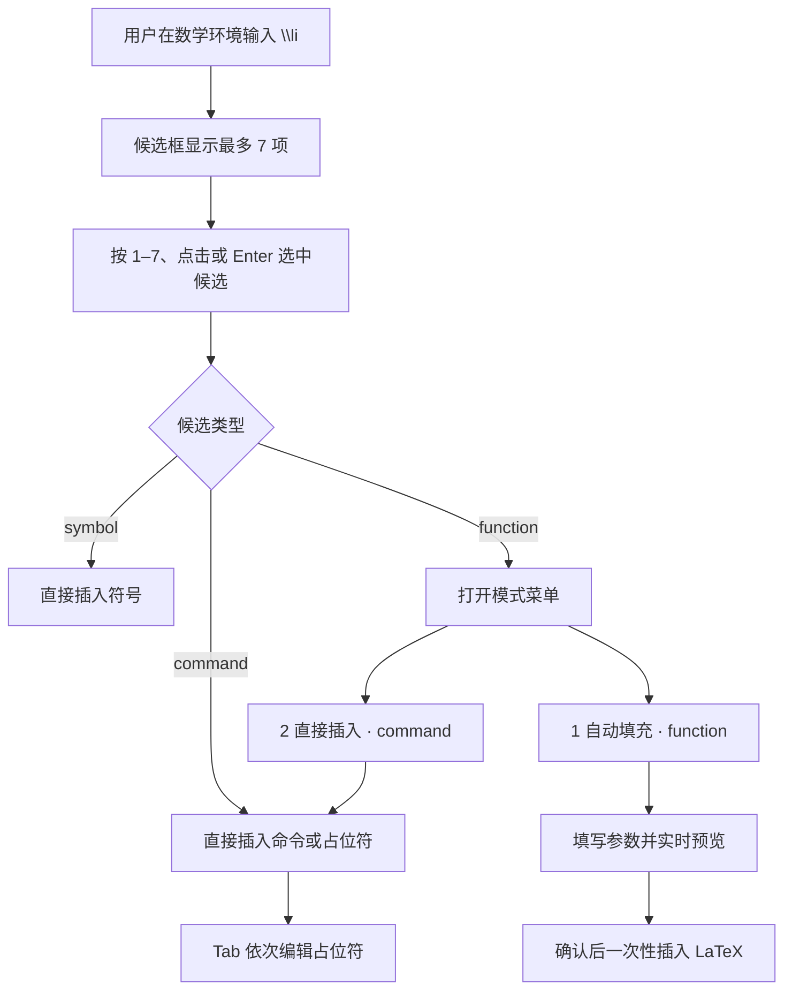
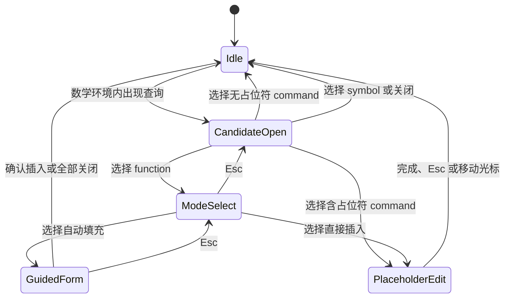
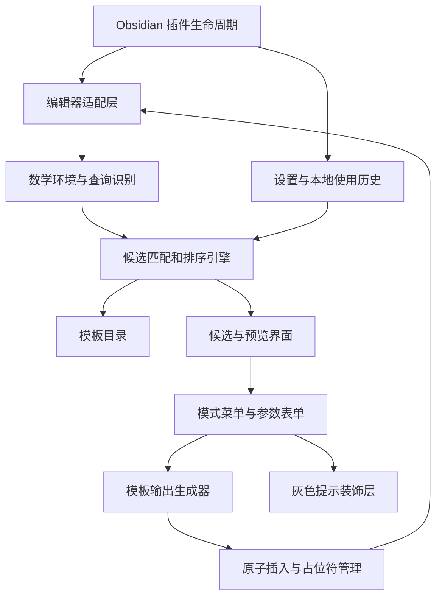

# Formula Pilot（公式领航）开发规范

> Guided LaTeX for Obsidian

| 项目属性 | 内容 |
|---|---|
| 文档类型 | 产品需求 + 交互规范 + 技术设计 |
| 文档状态 | MVP 最终开发基线 |
| 文档版本 | 1.0 |
| 更新日期 | 2026-07-13 |
| 插件名称 | Formula Pilot |
| 中文名称 | 公式领航 |
| 插件 ID | `formula-pilot` |
| 项目目录建议 | `obsidian-formula-pilot` |
| 首发平台 | Obsidian 桌面端 |

---

## 1. 文档目的

本文档定义 Formula Pilot 的 MVP 开发边界、用户交互、候选排序、模板体系、技术架构、异常处理、测试要求与验收标准。

开发者应当能够仅依据本文档完成 MVP，而不需要从历史讨论中推断产品行为。未在本文档中明确列入 MVP 的能力，默认不属于首版开发范围。

本文档描述的是开发基线，不包含具体代码实现。

---

## 2. 产品概述

Formula Pilot 是一个 Obsidian 数学公式输入辅助插件。用户在 LaTeX 数学环境内输入命令前缀时，插件显示相关候选、实际公式预览和完整 LaTeX，并允许用户通过数字键快速选择。

对于极限、求和、积分等结构化公式，插件提供两种使用方式：

1. **自动填充模式 `function`**：通过参数表单完成公式，适合初学者。
2. **直接插入模式 `command`**：插入带占位符的 LaTeX，适合熟悉 LaTeX 的用户。

插件的核心承诺是：

> 让用户像使用代码编辑器补全函数一样，在 Obsidian 中发现、理解并填写数学公式。

---

## 3. 设计原则

### 3.1 相似度优先

候选排序首先服从输入相似度。使用频率、最近使用和内置热度只能调整相似度相同的结果，不能让低相似度候选超过高相似度候选。

### 3.2 确认前不修改正文

自动填充过程中的灰色参数提示、括号和公式预览均为临时界面。用户最终确认前，不得把半成品写入 Markdown。

### 3.3 新手可理解，熟练用户可跳过引导

同一个结构化模板同时提供 `function` 和 `command` 两种模式。插件不能强迫熟练用户填写表单，也不能要求初学者理解完整 LaTeX 后才能使用。

### 3.4 键盘优先，鼠标完整可用

所有核心流程必须能够仅使用键盘完成，同时保留鼠标悬停、点击和滚动操作。

### 3.5 本地、稳定、可预测

MVP 不依赖网络、AI 或云服务。在模板目录、设置和本地使用历史快照相同的条件下，相同输入与相同上下文必须产生完全相同的候选顺序。

### 3.6 遵循 Obsidian 外观

菜单、字体、颜色、焦点状态和深浅主题应尽量继承 Obsidian 的设计变量，不建立与编辑器割裂的独立视觉体系。

---

## 4. 术语

| 术语 | 定义 |
|---|---|
| 数学环境 | `$...$` 或 `$$...$$` 包围的 LaTeX 输入区域 |
| 查询词 | 当前反斜杠之后、光标之前用于搜索的文本，例如 `\li` 中的 `li` |
| 候选项 | 候选框中的一个命令、符号或结构化模板 |
| `symbol` | 无需参数的单一符号，例如 `\infty` |
| `command` | 可直接插入的 LaTeX 命令或带占位符命令 |
| `function` | 产品中的“结构化、可引导填写模板”标签，不严格等同于数学意义上的函数 |
| 模式菜单 | 选中结构化模板后，用于选择自动填充或直接插入的二级菜单 |
| 参数表单 | 自动填充模式中填写变量、上下界和表达式的快捷菜单 |
| 灰色提示 | 显示在公式位置、但不写入 Markdown 的临时参数结构 |
| 占位符 | 直接插入后可通过 Tab 依次编辑的字段 |

---

## 5. 目标与非目标

### 5.1 MVP 目标

MVP 用于验证以下四个假设：

1. 候选补全能够降低 LaTeX 命令记忆成本。
2. 数字键 `1–7` 能提高候选选择速度。
3. 悬停或高亮预览能帮助用户选择正确模板。
4. 参数化自动填充比直接编辑 LaTeX 更适合初学者。

### 5.2 MVP 非目标

MVP 不尝试成为完整公式编辑器、数学计算器或 AI 数学助手。以下能力明确不在首版范围：

- AI 生成公式；
- 开放式中文自然语言转 LaTeX（冻结目录内的中文与拼音快捷搜索除外）；
- 计算极限、积分或方程结果；
- 完整 LaTeX 语法检查；
- 手写识别、OCR 或图片转公式；
- 用户自定义模板编辑器；
- 模板市场或云端同步；
- 可视化矩阵单元格编辑器；
- 复杂多行环境表单，例如 `cases`、`aligned`；
- 自动修复整篇笔记中的公式；
- 移动端专用交互；
- 多光标编辑；
- 用户行为遥测。

---

## 6. MVP 功能范围

### 6.1 必须包含

- 仅在 `$...$` 和 `$$...$$` 内自动触发；
- 使用标准 LaTeX 反斜杠 `\` 触发，例如 `\li`；
- 相似度优先的模糊匹配；
- 一屏最多 7 个带数字标签的候选；
- 主键盘和数字小键盘 `1–7` 快速选择；
- 方向键、Enter、Esc、Tab 和鼠标操作；
- 候选的实际公式预览、完整命令和简短说明；
- `symbol`、`command`、`function` 三类候选；
- `function` 的二级模式菜单；
- 自动填充参数表单；
- 公式位置的灰色临时提示；
- 参数变更后的实时预览；
- 直接插入后的 Tab 占位符；
- 模板初始替换形成单个撤销事件；
- 本地设置与可选的本地使用频率；
- 深色、浅色主题适配；
- 弹窗边缘自动避让。

### 6.2 平台边界

MVP 仅承诺 Obsidian 桌面端体验，覆盖 macOS、Windows 和 Linux。移动端可以允许插件加载，但不作为 MVP 验收平台；如果无法保证正确行为，应明确标记桌面端限定。

MVP 开发和验收基线锁定为 Obsidian Desktop 1.12.7 Public 或更高的桌面版本；首发 `minAppVersion` 暂定为 `1.12.7`。如果实现验证证明所用 API 可以安全支持更早版本，可以在发布前降低该值，但不得在缺少回归测试的情况下扩大兼容范围。Obsidian 1.12.7 是截至本文档日期最近的公开稳定桌面版本。[Obsidian 1.12.7 Desktop 更新记录](https://obsidian.md/changelog/2026-03-23-desktop-v1.12.7/)

MVP 支持 Source mode 和 Live Preview 中的编辑行为；Reading View 明确不在输入交互范围。所有依赖编辑器内部能力的代码必须封装在适配层中，避免内部 API 变化扩散到排序和模板逻辑。

---

## 7. 核心用户流程



### 7.1 典型极限流程

1. 用户在 `$$...$$` 内输入 `\li`。
2. 插件显示 `limit`、`liminf`、`limsup` 等候选。
3. 用户按数字 `1` 选中 `limit`。
4. 因为 `limit` 支持结构化填写，插件打开模式菜单。
5. 用户按 `1` 或 Enter 进入自动填充。
6. 参数表单依次收集变量、趋近值、方向和表达式。
7. 公式位置同步显示浅灰色的 `(变量 → 趋近值) (表达式)`。
8. 最后一项按 Enter，插件一次性插入 `\lim_{x\to 0} f(x)`。
9. 在用户尚未继续编辑占位符时，一次撤销应恢复原查询和原选择。

---

## 8. 数学环境识别与触发

### 8.1 自动触发范围

MVP 自动触发范围：

- 行内数学：`$...$`；
- 块级数学：`$$...$$`。

以下位置不得自动触发：

- 普通 Markdown 正文；
- 行内代码与代码块；
- YAML 属性区；
- 被转义的美元符号附近；
- 光标不在有效编辑器中的情况。

### 8.2 触发条件

满足以下条件时打开或更新候选框：

1. 光标位于支持的数学环境；
2. 光标前存在未结束的反斜杠命令前缀；
3. 查询词只包含 Unicode 字母，MVP 查询词不包含数字；
4. 当前不是输入法组合输入阶段；
5. 没有其他 Formula Pilot 会话处于活动状态。

标准触发示例：

```latex
\l
\li
\sum
\fra
```

MVP 不把正斜杠 `/` 作为默认 LaTeX 触发符。后续可以把 `/` 别名做成可选设置，但不进入首版。因为候选框打开时裸数字 `1–7` 固定用于选择候选，MVP 查询词明确不支持数字；需要在公式中继续输入数字时，用户可以按 Esc 关闭候选后正常输入。

### 8.3 手动触发

提供一个可配置命令，但不注册默认快捷键，避免与 macOS 输入源切换、Obsidian 或其他插件冲突。用户可以在 Obsidian 快捷键设置中自行绑定；手动触发仍然必须位于数学环境中。

手动触发时如果光标前存在有效查询，则按该查询排序；如果不存在查询，则显示内置优先级最高的 7 个结构化候选，插入范围为光标处的零长度范围。无查询的手动菜单不提供独立搜索输入框；用户键入普通字符时关闭菜单并把字符交还编辑器。

### 8.4 识别策略

数学环境识别以 CodeMirror/Lezer 语法树为权威来源，不以搜索最近 `$` 字符的方式作为主要实现：

- 支持 Source mode 和 Live Preview；
- 行内 `$...$` 不跨越换行；
- 块级 `$$...$$` 可以跨越换行；
- 被转义的 `\$` 不作为数学定界符；
- 代码块、行内代码、YAML、注释或其他非数学语法节点一律排除；
- 定界符不平衡、语法树尚未确认或当前位置存在歧义时，默认不自动触发；
- 手动触发也必须通过同一数学环境判定，不绕过安全边界。

为了性能，可以只遍历光标所在语法分支和必要父节点；不得通过全文字符串扫描替代语法树判断。

### 8.5 关闭条件

发生以下任一情况时关闭候选框：

- 用户按 Esc；
- 光标离开数学环境；
- 用户点击编辑器其他位置；
- 用户切换笔记或窗格；
- 查询词被删除；
- 用户使用左右方向键主动离开查询位置；
- 当前输入不再构成候选查询。

同一个未变化查询被用户主动关闭后，不应立即再次自动弹出；查询变化后才能重新触发。

---

## 9. 候选框规范

### 9.1 布局

候选框采用“列表 + 预览”布局：

```text
┌──────────────────────────┬────────────────────────────┐
│ 1  极限模板     function │  渲染结果                  │
│ 2  极限符号      command │                            │
│ 3  下极限        command │  完整命令                  │
│ 4  上极限        command │  \lim_{x\to 0} f(x)       │
│                          │                            │
│                          │  变量 → 趋近值 → 表达式    │
└──────────────────────────┴────────────────────────────┘
```

候选行至少包含：

- 数字标签；
- 中文名称或主要显示名称；
- LaTeX 命令或简写；
- 浅灰色类型标签；
- 当前高亮状态。

### 9.2 数字标签

- 当前可见候选按 `1–7` 编号；
- 数字采用等宽字体；
- 数字标签为低对比度圆角矩形；
- 当前高亮项的数字标签同步高亮；
- 编号仅是快捷键提示，不属于候选名称。

### 9.3 超过 7 个结果

- 同时可见且可数字选择的候选不得超过 7 项；
- 结果采用离散分页，每页最多 7 项；
- 上下方向键在页内移动；从页尾继续向下进入下一页首项，从页首继续向上进入上一页末项；
- PageUp/PageDown 明确切换整页，滚轮按整页切换；
- 页面变化后，当前页结果重新映射到 `1–7`；
- 数字始终选择当前可见页面中的对应项；
- 页面变化时必须给出明确的页码或结果范围提示，例如 `8–14 / 23`。

### 9.4 位置与避让

首选位置为光标下方。空间不足时按以下顺序避让：

1. 光标下方；
2. 光标上方；
3. 水平方向调整；
4. 将预览从右侧切换到下方；
5. 使用紧凑预览。

候选框和预览不得遮挡当前正在编辑的关键公式内容，也不得超出当前 Obsidian 窗口。

### 9.5 预览内容

高亮或悬停候选时，预览区显示：

1. 实际渲染结果；
2. 完整 LaTeX；
3. 一句简短中文说明；
4. 参数填写顺序；
5. 候选类型。

预览失败时显示完整 LaTeX 和“暂时无法渲染”，候选列表本身仍应可操作。

---

## 10. 候选排序规范

### 10.1 总原则

排序采用字典序比较键，不使用允许低优先级因素覆盖高优先级因素的加权总分。完整比较键固定为：

```text
[
  matchRank ASC,
  stringDistance ASC,
  usageCount DESC,
  lastUsedAt DESC,
  builtinPriority DESC,
  stableId ASC
]
```

依次比较每个字段；只有前一个字段完全相同，才比较下一个字段。缺失的 `usageCount`、`lastUsedAt` 和 `builtinPriority` 均视为 `0`。`stableId` 使用 Unicode 码点升序，不依赖系统 locale。

### 10.2 匹配等级

由高到低定义为：

| 等级 | 类型 | 示例 |
|---|---|---|
| 1 | 完全规范触发词匹配 | `lim` → `limit.general` 或 `\lim` |
| 2 | 中文主名称、中文别名或拼音别名完全匹配 | `分数` / `fenshu` → `fraction.guided` |
| 3 | 规范触发词前缀匹配 | `li` → `lim` |
| 4 | 英文名称前缀匹配 | `limit` → `limit template` |
| 5 | 英文别名前缀或完整匹配 | `integral` → `\int` |
| 6 | 拼音前缀匹配 | `fen` → `fraction.guided` |
| 7 | 英文字符顺序匹配 | `lmt` → `limit` |
| 8 | 英文或拼音拼写纠错匹配 | `lmi` → `lim`，`fensuh` → `fenshu` |
| 9 | 中文名称、中文别名或说明前缀匹配 | `分` → `分数模板` |

任何较低等级候选都不能因为更常用而超过较高等级候选。

### 10.3 查询归一化与距离

查询和候选搜索字段在匹配前执行以下归一化：

1. 去除查询开头的一个反斜杠；
2. Unicode NFKC 归一化；
3. ASCII 字母转为小写；
4. 去除首尾空白；
5. 保留中文等 Unicode 字母；拼音查询只与目录内冻结的无声调字段比较，不在运行时转换。

每个候选包含一个 `canonicalTrigger`、一个英文主名称、一个中文主名称，以及固定的英文别名、中文别名和拼音别名。拼音统一使用小写、无声调、无空格形式，不支持首字母缩写；`乘`、`和`、`属`、`缪` 分别冻结为 `cheng`、`he`、`shu`、`miu`。多个字段命中时，取最优的 `(matchRank, stringDistance)`，不累计分数。基础候选的英文主名称固定等于 `canonicalTrigger`，英文别名固定为空；结构化候选的搜索字段冻结在目录数据中。新增或修改搜索字段视为目录变更，必须同步更新排序快照。

`stringDistance` 定义如下：

- 完全匹配：`0`；
- 前缀匹配：候选字段长度减查询长度；
- 字符顺序匹配：最短匹配窗口长度减查询长度，再加窗口内跳过字符数；
- 拼写纠错：标准 Levenshtein 距离，仅查询长度至少为 3 时启用；长度 3–5 最大距离为 1，长度 6 以上最大距离为 2；
- 中文名称匹配采用完全或前缀距离；拼音支持完全、前缀和同一阈值的 Levenshtein 纠错，不做分词、模糊音或语义相似度。

候选字段既不以前缀、子序列，也不在允许编辑距离内命中时，不进入结果集。

### 10.4 MVP 上下文边界

MVP 使用语法上下文判断是否处于数学环境、查询范围是否有效以及菜单应否关闭，但不根据公式前文重新排列候选，也不生成目录外的“下一步组合候选”。例如在 `\lim_{x` 后可以通过输入 `\to` 搜索目录中的 `arrow.to`，但 MVP 不主动生成 `\to 0`、`\to \infty` 等组合项。

上下文重排和下一步结构建议属于 MVP 之后的独立功能。在引入前必须新增冻结的场景映射和排序快照，不能以未定义的 `contextRank` 接入当前比较器。

### 10.5 使用历史

- 使用历史仅保存在本地；
- 默认可以开启，但必须提供关闭选项；
- 关闭后，排序回退到内置优先级和稳定 ID；
- 使用历史不得造成匹配等级跨越；
- 清除历史后候选顺序应恢复到确定性的内置排序。

`usageCount` 最大保存为 `1,000,000`，继续使用时保持上限；`lastUsedAt` 使用 Unix 毫秒时间戳。排序以一次查询开始时取得的历史快照为准，在候选框保持打开期间不得因为历史写入重新排序。

### 10.6 默认黄金排序

在默认设置、空使用历史和普通数学上下文中，以下结果必须固定：

| 查询 | 前序候选稳定 ID |
|---|---|
| `li` | `limit.general`、`command.lim`、`limit.left`、`limit.right`、`command.liminf`、`command.limsup` |
| `lim` | `limit.general`、`command.lim`、`limit.left`、`limit.right`、`command.liminf`、`command.limsup` |
| `fra` | `fraction.guided`、`command.frac` |
| `sum` | `summation.guided`、`command.sum` |
| `inf` | `symbol.infty` |

这些顺序由结构化模板目录中的共享 `canonicalTrigger` 和 `builtinPriority` 冻结。实现必须为黄金排序建立自动化测试。

---

## 11. 候选类型与模板体系

### 11.1 `symbol`

用于不需要参数的单一符号：

```latex
\infty
\alpha
\partial
\rightarrow
\subseteq
```

选中后直接插入，不显示模式菜单。

### 11.2 `command`

用于基础命令或简单占位符结构：

```latex
\lim
\sum
\frac{}{}
\sqrt{}
```

如果存在占位符，插入后自动选中第一个占位符，并允许 Tab 移动。

### 11.3 `function`

用于需要语义参数的结构化模板：

```latex
\lim_{x\to 0} f(x)
\sum_{i=1}^{n} a_i
\int_{a}^{b} f(x)\,dx
```

选中后必须打开模式菜单，让用户选择自动填充或直接插入。

### 11.4 模板数据要求

每个模板必须声明：

| 字段 | 说明 |
|---|---|
| 稳定 ID | 更新版本后仍保持不变的内部标识 |
| 名称 | 主要显示名称与中文名称 |
| 类型 | `symbol`、`command` 或 `function` |
| 触发词 | 命令、英文别名、中文别名 |
| 分类 | 极限、微积分、代数、集合等 |
| 参数 | 参数 ID、名称、默认值、输入类型、是否必填 |
| 预设 | 左极限、右极限等候选变体 |
| 输出规则 | 参数如何组成最终 LaTeX |
| 灰色提示规则 | 编辑器临时提示的布局 |
| 预览规则 | 参数变化后如何生成渲染源码 |
| 占位符顺序 | 直接插入模式中的 Tab 顺序 |
| 光标终点 | 模板完成后的最终光标位置 |
| 搜索元数据 | 别名、关键词和内置热度 |

模板数据与界面逻辑必须分离。新增普通模板时，应主要通过添加数据完成，而不是修改候选框或参数表单代码。

---

## 12. 模式菜单

### 12.1 打开条件

只有支持 `function` 的结构化候选需要模式菜单。`symbol` 和纯 `command` 直接执行。

### 12.2 菜单内容

```text
┌─────────────────────────────┐
│ limit                       │
│                             │
│ 1  自动填充     function    │
│ 2  直接插入     command     │
└─────────────────────────────┘
```

- 第一项默认高亮；
- `function` 和 `command` 使用浅灰色标签；
- Enter 进入当前高亮模式；
- 数字 `1` 进入自动填充；
- 数字 `2` 进入直接插入；
- 上下方向键切换；
- Esc 返回候选框；
- 点击菜单外部关闭整个交互。

候选框和模式菜单都是不夺取 DOM 焦点的虚拟菜单，真实焦点继续留在活动编辑器。状态机拥有规定快捷键的“逻辑键盘所有权”。进入参数表单后，DOM 焦点才转移到第一个表单控件；返回或关闭时焦点恢复到原编辑器。

ModeSelect 中输入规定快捷键以外的可打印字符时，模式菜单关闭、原查询保持不变，并把该字符交还编辑器处理；不得静默吞掉字符。

### 12.3 不自动跳过

MVP 可以记录上次使用模式用于默认高亮，但不得自动跳过模式菜单。这样可以保持行为可见并降低误插入风险。

---

## 13. 自动填充模式

### 13.1 参数表单

极限模板示例：

```text
┌──────────────────────────────┐
│ limit               function │
│                              │
│ 变量       [ x           ]   │
│ 趋近于     [ 0           ]   │
│ 方向       [ 双侧极限  ▾ ]   │
│ 表达式     [ f(x)        ]   │
│                              │
│ 预览：lim f(x)               │
│       x→0                    │
│                              │
│ Enter 下一项 · Cmd+Enter 插入│
└──────────────────────────────┘
```

参数控件支持：

- 单行文本；
- 单选或下拉选择；
- 可选字段；
- 默认值；
- 简短说明；
- 基础空值验证。

进入表单或移动到下一个文本字段时，默认值必须全选，因此用户直接键入会替换默认值，而不是追加在默认值末尾。用户用鼠标重新定位光标后，遵循普通文本输入行为。

MVP 不需要通用复杂表单引擎，不支持嵌套模板表单。

### 13.2 键盘操作

| 状态 | 按键 | 行为 |
|---|---|---|
| 参数表单 | Tab | 下一个字段 |
| 参数表单 | Shift + Tab | 上一个字段 |
| 参数表单 | Enter | 确认当前字段并进入下一字段 |
| 最后字段 | Enter | 生成并插入公式 |
| 任意字段 | Ctrl/Cmd + Enter | 立即校验并插入 |
| 参数表单 | Esc | 返回模式菜单，不写入正文 |
| 下拉字段 | ↑ / ↓ | 切换选项 |

参数表单打开后，普通数字键用于填写参数，不再作为候选快捷键。

### 13.3 灰色提示

参数表单打开时，在原查询位置显示只读临时提示。例如：

```text
lim  (变量 → 趋近值)  (表达式)
```

填写后逐步变为：

```text
lim  (x → 趋近值)  (表达式)
lim  (x → 0)       (表达式)
lim  (x → 0)       (f(x))
```

要求：

- 灰色提示不得写入 Markdown；
- 提示不得进入复制内容；
- 提示不应改变撤销历史；
- 参数变化后提示及时更新；
- 窗格滚动、切换或光标变化时正确移动或关闭；
- 取消自动填充后完全清除。

实现方式固定为：使用 `Decoration.replace` 在视觉上覆盖原查询范围 `[queryFrom, queryTo]`，并由 Widget 显示灰色结构。底层文档仍保留原查询，例如 `\li`；复制、保存和撤销历史只看到底层文档。方向为左侧或右侧时，Widget 文本分别显示 `0⁻` 或 `0⁺`。返回模式菜单或候选框时移除 replacement decoration，重新显示原查询。

### 13.4 参数验证

MVP 只进行结构验证：

- 必填字段不能为空；
- 文本参数按 LaTeX 片段处理，而不是按普通文本转义；
- 文本参数中的花括号必须配对，未配对时阻止确认并定位到对应字段；
- 枚举字段必须为允许值；
- 阶数等正整数参数必须为空或为正整数；
- 输出生成后必须是非空字符串。

MVP 不判断数学意义是否正确，也不阻止用户填写任意合法 LaTeX 表达式。

模板生成器负责在参数外添加模板所需的花括号。例如参数值为 `x+1` 时，分子输出为 `{x+1}`；用户不需要自己输入外围花括号。参数内部仍允许使用合法的嵌套 LaTeX，例如 `\frac{a}{b}`。

### 13.5 确认插入

确认后应：

1. 移除原始查询前缀，例如 `\li`；
2. 清除灰色提示和参数菜单；
3. 插入完整 LaTeX；
4. 把整个变化记录为一次可撤销操作；
5. 将光标放到模板定义的最终位置；
6. 记录一次本地使用行为（如果用户允许）。

---

## 14. 直接插入模式与占位符

用户选择 `command` 后，插件立即插入模板，并激活占位符。

极限示例：

```latex
\lim_{x\to 0} f(x)
```

占位符顺序：

```text
① x
② 0
③ f(x)
④ 跳出模板
```

要求：

- 第一个占位符自动选中；
- 输入内容替换当前占位符默认值；
- Tab 进入下一个占位符；
- Shift + Tab 返回上一个占位符；
- Esc 结束占位符模式并保留当前文本；
- 最后一次 Tab 把光标移到整个模板之后；
- 用户主动移动光标时结束占位符模式；
- “用模板初始文本替换原查询”的事务只占一个撤销步骤；用户随后在占位符内的编辑遵循 CodeMirror 正常撤销历史。

一次撤销的验收边界为：模板初始文本插入后、用户尚未编辑任何占位符时执行 Undo，必须恢复原查询、原选择和原光标位置。MVP 不承诺用户完成多次占位符编辑后一次 Undo 删除整条公式。

---

## 15. MVP 模板目录

MVP 提供附录 E 冻结的 60 个 `symbol`/`command` 候选，以及 12 个结构化模板候选，共 72 项。

### 15.1 结构化模板

| 模板 | 主要参数 | 示例输出 |
|---|---|---|
| 一般极限 | 变量、趋近值、方向、表达式 | `\lim_{x\to 0} f(x)` |
| 左极限预设 | 变量、趋近值、表达式 | `\lim_{x\to 0^-} f(x)` |
| 右极限预设 | 变量、趋近值、表达式 | `\lim_{x\to 0^+} f(x)` |
| 求和 | 索引、起点、终点、表达式 | `\sum_{i=1}^{n} a_i` |
| 乘积 | 索引、起点、终点、表达式 | `\prod_{i=1}^{n} a_i` |
| 定积分 | 变量、下限、上限、被积函数 | `\int_a^b f(x)\,dx` |
| 不定积分 | 变量、被积函数 | `\int f(x)\,dx` |
| 分数 | 分子、分母 | `\frac{a}{b}` |
| 根式 | 根指数、被开方表达式 | `\sqrt[n]{x}` |
| 普通导数 | 函数、变量、阶数 | `\frac{d^n f}{dx^n}` |
| 偏导数 | 函数、变量、阶数 | `\frac{\partial^n f}{\partial x^n}` |
| 二项式系数 | 上参数、下参数 | `\binom{n}{k}` |

一般极限、左极限和右极限可以共享同一个底层模板，通过不同默认参数作为三个候选预设展示。

### 15.2 基础命令分类

60 个基础候选覆盖：

- 希腊字母；
- 无穷大与常量；
- 箭头；
- 集合关系；
- 比较关系；
- 逻辑符号；
- 常见运算符；
- 上标、下标相关结构；
- 三角与对数函数；
- 括号和定界符；
- 基础微积分符号。

具体稳定 ID、规范触发词和默认插入内容见附录 E。实现中的模板目录必须与该清单逐项对应。

---

## 16. 键盘与鼠标行为总表

### 16.1 候选框

| 输入 | 行为 |
|---|---|
| `1–7` | 选择当前可见的对应候选 |
| 数字小键盘 `1–7` | 与主键盘相同 |
| ↑ / ↓ | 移动高亮并更新预览 |
| Enter | 选择高亮候选 |
| Tab | 选择高亮候选 |
| Esc | 关闭候选框 |
| 鼠标悬停 | 高亮并更新预览 |
| 鼠标单击 | 选择候选 |
| 滚轮 | 浏览更多候选 |

候选框不夺取编辑器焦点。Unicode 字母、Backspace 等查询编辑按键继续由编辑器处理，随后候选根据新查询更新；只有表中明确列出的候选操作键由插件消费。

### 16.2 模式菜单

| 输入 | 行为 |
|---|---|
| `1` | 自动填充模式 |
| `2` | 直接插入模式 |
| ↑ / ↓ | 切换模式 |
| Enter | 进入高亮模式 |
| Esc | 返回候选框 |

### 16.3 参数表单

参数表单打开后，数字键必须作为普通参数输入，不再选择候选。输入法处于组合输入阶段时，不得截获数字、Enter 或方向键完成插件操作。

### 16.4 数字冲突规则

当状态为 `CandidateOpen` 或 `ModeSelect`，且其所属 EditorView 是当前活动视图时，状态机拥有文档规定快捷键的逻辑所有权；候选框和模式菜单不得夺取编辑器 DOM 焦点。其他所有状态下，数字必须正常写入公式或参数。

每个原始 `keydown` 事件最多触发一次状态转换。处理器在消费快捷键时先执行默认行为阻止与传播停止，再改变状态；新状态不得重新处理同一事件。数字选择、Enter 和 Tab 默认忽略 `event.repeat`，避免长按连续跨越多个状态。

关闭“数字快捷选择”设置后，CandidateOpen 中的 `1–7` 一律作为普通编辑器输入，模式菜单仍保留 `1/2`，因为它不是公式查询输入状态。用户仍可通过方向键、Enter 或鼠标选择候选。

---

## 17. 交互状态机

插件必须使用明确的单一状态机管理交互：



补充状态规则：

- CandidateOpen 中查询变化会留在 CandidateOpen 并重新计算结果；
- 无结果是 CandidateOpen 的空结果子状态，不创建第二套菜单；
- 点击外部、切换窗格、范围失效或插件卸载会使任何状态立即回到 Idle；
- ModeSelect 或 GuidedForm 中原查询范围被外部事务破坏时立即取消；
- PlaceholderEdit 在最后一次 Tab 后回到 Idle；
- 每个 EditorView 有独立控制器，但整个 Workspace 同时最多允许一个非 Idle 会话；激活另一视图时旧控制器立即转为 Idle；
- function 的直接插入结果如果没有占位符，则插入后直接回到 Idle。

状态要求：

- 同一编辑器内只能存在一个活动 Formula Pilot 会话；
- 切换编辑器或笔记时结束旧会话；
- 每个状态明确拥有自己的键盘规则；
- 状态退出时必须清理弹窗、装饰、事件监听和临时数据；
- 异常发生时优先回到 `Idle`，不得留下无法关闭的界面。

---

## 18. 技术架构

### 18.1 总体结构



### 18.2 插件主体

负责：

- 插件加载与卸载；
- 注册编辑器扩展和命令；
- 加载模板目录；
- 加载和保存设置；
- 创建每个编辑器会话的控制器；
- 在卸载时清理全部资源。

### 18.3 编辑器适配层

Obsidian 使用 CodeMirror 作为底层编辑器，并提供通用 `Editor` 接口。架构采用隔离式混合方案：

- 文档级读写优先通过 Obsidian 提供的编辑器能力；
- 候选触发、精确按键、装饰与占位符通过受控的 CodeMirror 编辑器扩展完成；
- 所有 CodeMirror 相关细节封装在 `editor-adapter` 边界内；
- 排序、模板和输出生成不得直接依赖编辑器对象。

参考：[Obsidian Editor 开发文档](https://docs.obsidian.md/Plugins/Editor/Editor)。

### 18.4 数学环境与查询识别器

输入：当前编辑器状态与光标位置。

输出：

- 是否处于支持的数学环境；
- 查询起止位置；
- 查询词；
- 光标附近的有限上下文；
- 是否应关闭当前会话。

识别器必须限制检查范围，避免每次输入都扫描整个文档。

### 18.5 排序引擎

排序引擎是纯逻辑模块：

- 不访问 DOM；
- 不直接读取编辑器；
- 不请求网络；
- 接收查询、模板目录和可选使用历史；数学上下文只由识别器用于决定是否触发，不参与 MVP 排序；
- 返回稳定排序后的候选及匹配原因。

建议为每个候选保留调试信息，例如匹配等级、命中字段和字符串距离，便于测试排序问题。正式 UI 不必展示这些信息。

### 18.6 模板引擎

职责：

- 读取结构化模板定义；
- 生成参数表单描述；
- 将参数转换为预览 LaTeX；
- 将参数转换为最终 LaTeX；
- 生成直接插入占位符位置；
- 提供默认参数和预设。

模板引擎不得负责渲染 DOM 或插入编辑器。

### 18.7 UI 控制器

统一管理：

- 候选框；
- 预览面板；
- 模式菜单；
- 参数表单；
- 焦点与键盘所有权；
- 屏幕边缘避让；
- 深浅主题与可访问性属性。

候选框和模式菜单使用编辑器焦点下的虚拟 listbox 模式；参数表单才接管 DOM 焦点。按键监听应具有明确的状态守卫，并尊重输入法 composition、Obsidian 已消费事件和其他插件的高优先级处理。无法安全取得快捷键所有权时，宁可不触发快捷选择，也不能吞掉普通输入。

界面应挂载到当前编辑器所属的窗口，而不是假设所有编辑器都位于主窗口，以兼容 Obsidian 弹出窗口。

### 18.8 灰色提示装饰层

灰色提示使用编辑器 Decoration/Widget 机制表达，而不是写入文档。官方 Decorations 文档明确区分标记、Widget、替换和行装饰，并建议视口相关显示优先考虑 View Plugin。[Obsidian Decorations 开发文档](https://docs.obsidian.md/Plugins/Editor/Decorations)

### 18.9 公式渲染适配层

渲染层只接收 LaTeX 字符串并返回预览结果。MVP 使用 Obsidian API 导出的 `renderMath` 作为唯一公式渲染入口，并按当前 API 要求在批量渲染后调用 `finishRenderMath`；不额外打包 KaTeX、MathJax 或第二套公式引擎。渲染产生的元素由当前预览会话持有，候选变化或会话关闭时立即清理。

渲染失败不能阻塞候选选择或插入。渲染层需要支持取消或忽略过期结果，防止用户快速切换候选时旧预览覆盖新预览。

### 18.10 插入与占位符管理

插入模块负责：

- 替换原查询范围；
- 一次性写入最终 LaTeX；
- 保证模板初始替换形成单个撤销事件；
- 建立占位符位置；
- 在文档变化后映射占位符；
- 结束占位符模式时清理状态。

最终替换通过所属 EditorView 的单个 CodeMirror transaction 完成：该 transaction 同时包含查询范围替换、初始 selection 和一次 history event。不得先删除查询再执行第二次插入。事务完成后再建立占位符状态；如果事务前的查询范围或文档版本已失效，则放弃插入并回到 Idle。

### 18.11 设置与存储

只存储：

- 用户设置；
- 模板 ID 对应的使用次数；
- 最近使用时间；
- 上次高亮模式；
- 可选的调试开关。

设置数据带 `schemaVersion`。MVP 初始版本为 `1`；读取未知更高版本时使用安全默认设置且不覆盖原数据，读取缺失或旧版本时通过显式迁移函数升级。使用历史按稳定模板 ID 存储。

不得存储笔记内容、公式正文或输入历史。不得发送任何遥测。

---

## 19. 性能要求

### 19.1 响应预算

- 普通键入不能出现可感知卡顿；
- 在固定 72 个 MVP 候选和 1 MB 测试文档下，候选匹配连续执行 1,000 次的 P95 必须小于 16 ms；
- 从编辑器事务到候选列表 DOM 完成更新的 P95 必须小于 32 ms；
- 预览渲染可以稍晚，但不能阻塞候选列表；
- 参数输入时只更新当前灰色提示和预览，不重新扫描全文。

性能报告必须记录测试机器、操作系统、Obsidian 版本、主题和文档大小，使结果可复现。“没有明显卡顿”仅作为体验目标，不替代上述数值验收。

### 19.2 性能策略

- 只检查光标附近的必要文本；
- 只处理当前可见或当前活动编辑器；
- 模板目录加载后保持内存索引；
- 对重复预览结果使用有限缓存；
- 快速连续输入时合并过期预览任务；
- 不在每次按键时保存设置或使用历史。

Obsidian 编辑器本身采用视口机制处理大型文档；插件装饰也应限制在当前视口和当前会话附近。[Obsidian Viewport 文档](https://docs.obsidian.md/Plugins/Editor/Viewport)

---

## 20. 可访问性与主题

### 20.1 键盘可访问性

- 所有菜单项必须可通过键盘到达；
- 高亮状态不能只依赖颜色；
- 焦点移动顺序必须符合视觉顺序；
- Esc 行为必须一致；
- 关闭菜单后焦点返回编辑器。

### 20.2 视觉要求

- 使用 Obsidian 主题变量；
- 浅灰标签仍需保持可读对比度；
- 公式预览在深色和浅色背景下均清晰；
- 支持系统缩放和 Obsidian 字体大小变化；
- 不能仅通过红色或绿色表达错误与成功。

### 20.3 动效

MVP 只允许短暂淡入或位置调整，不使用复杂动画。系统设置“减少动态效果”时应禁用非必要动效。

---

## 21. 隐私与安全

- 所有匹配、模板生成和预览在本地完成；
- 不调用网络 API；
- 不上传笔记、公式或使用记录；
- 不包含用户行为遥测；
- 使用历史可关闭并可一键清除；
- 插件只修改当前用户明确确认的编辑器范围；
- 开发和测试应使用独立测试库，避免损坏真实笔记。

Obsidian 官方插件开发指南也建议在独立测试库中开发插件，以降低数据损失风险。[Obsidian 插件构建指南](https://docs.obsidian.md/Plugins/Getting%20started/Build%20a%20plugin)

---

## 22. 异常与边界行为

### 22.1 输入法组合输入

输入法处于 composing 状态时：

- 不执行数字快捷选择；
- 不用 Enter 确认候选；
- 不用方向键改变候选；
- 等组合输入结束后再更新查询。

### 22.2 编辑器失焦

编辑器失焦后：

- 点击 Formula Pilot 自身菜单不应意外关闭；
- 点击其他界面则关闭当前会话；
- 返回编辑器后不能保留失效的灰色提示。

### 22.3 文档在菜单打开时变化

如果查询范围被其他编辑操作破坏：

- 立即取消当前会话；
- 不尝试插入到猜测位置；
- 不留下装饰或弹窗。

### 22.4 多窗格与弹出窗口

- 每个编辑器维护独立会话；
- 只有当前活动会话接收快捷键；
- 菜单挂载到其所属窗口；
- 切换窗格时关闭旧窗格菜单。

### 22.5 预览错误

- 显示 LaTeX 源码；
- 显示非阻断提示；
- 允许继续插入；
- 不把渲染异常写入正文。

### 22.6 不完整或未知命令

未知查询可以显示拼写纠错结果。没有结果时显示紧凑空状态，并允许 Esc 关闭或继续输入；不得自动删除用户内容。

---

## 23. 设置项

MVP 设置保持精简：

| 设置 | 默认值 | 说明 |
|---|---|---|
| 启用数字快捷选择 | 开 | 候选框中使用 `1–7` |
| 显示公式预览 | 开 | 关闭后使用单栏紧凑候选框 |
| 记录本地使用频率 | 开 | 只用于同级候选排序 |
| 清除使用历史 | 操作按钮 | 恢复内置稳定排序 |
| 候选框字号 | 跟随 Obsidian | 提供小、默认、大 |
| 手动触发快捷键 | 无默认绑定 | 由用户在 Obsidian 中自行设置 |
| 模式默认高亮 | 自动填充 | 只改变高亮，不跳过模式菜单 |

手动触发命令不自带默认快捷键，表中的组合仅作为用户自行绑定时的示例。MVP 不提供自由配置候选数量；候选数字映射固定为 7 项。

---

## 24. 测试策略

### 24.1 单元测试

必须覆盖：

- 数学环境识别；
- 查询范围提取；
- 匹配等级；
- 同等级排序稳定性；
- 使用历史不能跨越匹配等级；
- MVP 上下文不得改变候选排序；
- 模板参数到 LaTeX 的输出；
- 左右极限方向；
- 特殊字符和花括号处理；
- 占位符顺序；
- 设置迁移与默认值。

### 24.2 集成测试

必须覆盖：

- 输入 `\li` 后候选出现；
- 数字 `1–7` 正确选择；
- 小键盘数字与主键盘一致；
- 选择 `function` 后打开模式菜单；
- 参数表单中的数字正常输入；
- Esc 逐级返回；
- 确认前 Markdown 不变化；
- 模板初始替换只产生一个撤销事件；
- Tab 按正确顺序切换占位符；
- 切换笔记或窗格后清理 UI；
- 深浅主题显示正确；
- 菜单靠近窗口边缘时正确避让。
- Source mode 与 Live Preview 行为一致；
- Reading View 不触发输入交互；
- 行内代码、代码块、YAML、转义美元和不平衡定界符不触发；
- 每个原始数字事件只发生一次状态转换；
- 参数字段首次聚焦时默认值全选；
- 关闭数字快捷选择后 `1–7` 正常写入查询；
- 超过 7 项时分页范围和数字映射正确；
- 主窗口和弹出窗口均挂载到正确 document 并正确清理；
- 使用历史重载和清除行为正确。

### 24.3 手动测试矩阵

| 维度 | 最低覆盖 |
|---|---|
| 操作系统 | macOS、Windows、Linux |
| 主题 | 默认浅色、默认深色、至少一个社区主题 |
| 数学环境 | 行内、块级 |
| 输入方式 | 英文键盘、至少一种中文输入法 |
| 窗口 | 主窗口、多窗格、弹出窗口 |
| 文档规模 | 短文档、长文档 |
| 选择方式 | 数字、方向键、Enter、鼠标 |

### 24.4 回归测试重点

- 数字键意外被吞；
- 输入法 Enter 被误判；
- 灰色提示残留；
- 弹窗焦点丢失；
- 插入范围错位；
- 撤销拆成多个步骤；
- 使用历史导致候选顺序跳动；
- 快速输入时旧预览覆盖新预览。

---

## 25. MVP 验收标准

以下条件全部满足才可认为 MVP 完成：

1. 候选框只在支持的数学环境中自动出现。
2. `\li`、`\sum`、`\fra` 等核心查询返回正确候选。
3. 候选以相似度等级优先，低相似度结果不能越级。
4. 一屏最多 7 项，并可通过主键盘和小键盘 `1–7` 选择。
5. `function` 候选打开两种模式菜单。
6. 自动填充支持参数填写、灰色提示和实时预览。
7. 参数表单中的数字不会触发候选快捷键。
8. 用户确认前 Markdown 内容完全不变。
9. 直接插入模式支持 Tab 占位符。
10. 模板初始替换可以一次撤销；后续占位符编辑遵循正常撤销历史。
11. 预览失败不阻塞候选选择和插入。
12. 所有菜单可以通过 Esc 正确关闭或返回。
13. 窗格切换、笔记切换和插件卸载后无残留 UI。
14. 深色和浅色主题下界面均清晰可用。
15. 12 个结构化模板预设均通过输出测试。
16. 不产生网络请求，不收集遥测。
17. 正常键入没有明显卡顿，候选匹配达到性能目标。
18. 手动触发命令只在有效数学环境内打开，且不注册默认热键。
19. Source mode 与 Live Preview 通过相同核心流程，Reading View 不触发。
20. 行内代码、代码块、YAML、转义美元和不平衡定界符不会误触发。
21. 鼠标可以完成候选选择、模式选择、参数填写与确认。
22. 超过 7 项时可以翻页，页码范围和 `1–7` 映射准确。
23. 关闭数字快捷选择后，候选框中的 `1–7` 正常写入正文。
24. 输入法 composing 期间数字、Enter 和方向键均不被截获。
25. 使用历史不能改变 `matchRank` 或 `stringDistance`；清除历史后恢复黄金排序。
26. 所有设置在插件重载后保持，清除操作立即生效。
27. 主窗口、多个窗格和弹出窗口中的菜单均挂载和清理正确。
28. 系统缩放、Obsidian 字号变化和减少动态效果设置下仍可使用。
29. 插件卸载时清除候选、表单、Decoration 和占位符状态。
30. 附录 E 的 60 个基础候选和 12 个结构化候选全部存在且稳定 ID 不重复。

---

## 26. 开发里程碑

### M0：编辑器可行性验证

- 数学环境识别；
- 光标锚点定位；
- 最小候选弹窗；
- 数字键截获与释放；
- 临时 Decoration；
- 模板初始替换的单次撤销。

通过条件：在测试库中完整演示 `\li → 候选 → 选择 → 插入`。

### M1：候选与预览

- 模板目录基础结构；
- 匹配等级与稳定排序；
- 7 项数字选择；
- 预览面板；
- 滚动分页；
- 边缘避让。

通过条件：附录 E 的 60 个基础候选全部可搜索，核心排序测试通过。

### M2：两种模式与模板引擎

- 模式菜单；
- 参数表单；
- 灰色提示；
- 实时预览；
- 直接插入占位符；
- 12 个结构化模板预设。

通过条件：极限、求和、积分等核心流程均可仅用键盘完成。

### M3：稳定性与发布准备

- 设置页面；
- 使用历史；
- 多窗格和弹出窗口；
- 输入法测试；
- 主题与可访问性；
- 性能与回归测试；
- 文档、图示和发布清单。

通过条件：全部 MVP 验收标准通过。

---

## 27. 主要风险与缓解措施

| 风险 | 影响 | 缓解措施 |
|---|---|---|
| 数学环境识别误判 | 普通文本中错误弹窗 | 限制扫描范围，覆盖代码块、转义和边界测试 |
| 数字键被错误截获 | 用户无法正常输入数字 | 只在活动 EditorView 的 CandidateOpen/ModeSelect 状态消费；参数表单不截获 |
| 输入法冲突 | 中文输入被打断 | composition 期间禁用插件确认键 |
| Decoration 锚点漂移 | 灰色提示位置错误 | 文档变化后映射位置；无法映射立即取消 |
| 候选顺序不稳定 | 数字肌肉记忆失效 | 分层排序；历史不得跨等级；最终稳定排序 |
| 预览渲染过慢 | 输入卡顿 | 列表和预览解耦；丢弃过期预览 |
| 二级菜单增加操作步骤 | 熟练用户感觉繁琐 | 提供直接插入模式和键盘 `2`；后续评估默认直达 |
| 编辑器内部 API 变化 | Obsidian 更新后失效 | 所有 CodeMirror 细节集中在适配层 |
| 社区主题样式冲突 | 菜单难以阅读 | 类名命名空间化并使用 Obsidian 主题变量 |

---

## 28. 发布前决策清单

以下事项在编码启动或发布前确认，但不改变 MVP 产品边界：

- 验证暂定 `minAppVersion = 1.12.7` 与实际 API 一致；
- 检查 Obsidian 社区插件目录中 `Formula Pilot` 与 `formula-pilot` 的最终名称冲突；
- 确认插件图标与许可证；
- 核对附录 E 的 60 个基础命令与实现目录一致；
- 选择用于测试的社区主题；
- 准备独立测试库；
- 确认 macOS、Windows、Linux 的测试负责人或测试环境。

---

## 29. 命名与文案规范

### 29.1 正式名称

- 英文：**Formula Pilot**
- 中文：**公式领航**
- 副标题：**Guided LaTeX for Obsidian**
- 插件 ID：`formula-pilot`
- Manifest `minAppVersion`：`1.12.7`
- Manifest `isDesktopOnly`：`true`

插件文件夹名必须与 ID 一致，即 `formula-pilot`。正式提交社区目录前必须再次确认名称唯一性；Obsidian Manifest 规范要求插件名称唯一，并要求 ID 只包含小写字母和连字符。[Obsidian Manifest 规范](https://docs.obsidian.md/Reference/Manifest)

### 29.2 模式文案

固定使用：

- `自动填充` + 浅灰色 `function`
- `直接插入` + 浅灰色 `command`
- 单一符号候选使用浅灰色 `symbol`

### 29.3 避免使用

- 不把自动填充描述为 AI；
- 不把预览描述为计算结果；
- 不承诺支持全部 LaTeX；
- 不使用“智能纠错”描述基础拼写容错；
- 不把 `function` 解释为严格的数学函数分类。

---

## 30. 开发完成定义（Definition of Done）

一个功能只有同时满足以下条件才算完成：

- 行为符合本文档；
- 有对应的自动化测试或明确的手动测试记录；
- 不破坏数字输入、输入法和普通 Markdown 编辑；
- 异常退出后不留下菜单或灰色提示；
- 深浅主题可用；
- 键盘和鼠标均可完成流程；
- 文档和设置说明同步更新；
- 相关 MVP 验收项已通过。

MVP 只有在第 25 节全部验收标准通过后才可发布为首个公开测试版本。

---

## 附录 A：极限模板详细定义

### A.1 参数

| 参数 ID | 显示名称 | 类型 | 默认值 | 必填 |
|---|---|---|---|---|
| `variable` | 变量 | 文本 | `x` | 是 |
| `target` | 趋近于 | 文本 | `0` | 是 |
| `direction` | 方向 | 枚举 | 双侧 | 是 |
| `expression` | 表达式 | 文本 | `f(x)` | 是 |

### A.2 方向映射

| 方向 | 输出 |
|---|---|
| 双侧 | 原样使用 target |
| 左侧 | 用 `{target}^{-}` 包裹 target |
| 右侧 | 用 `{target}^{+}` 包裹 target |

### A.3 输出

```text
output = "\\lim_{" + variable + "\\to " + directedTarget + "} " + expression
directedTarget(both)  = target
directedTarget(left)  = "{" + target + "}^{-}"
directedTarget(right) = "{" + target + "}^{+}"
```

### A.4 灰色提示

```text
双侧：lim  (variable → target)   (expression)
左侧：lim  (variable → target⁻)  (expression)
右侧：lim  (variable → target⁺)  (expression)
```

### A.5 直接插入占位符

```text
variable → target → expression → 模板末尾
```

---

## 附录 B：关键交互示例

### B.1 数字选择结构化候选

```text
用户：\li
系统：显示 1–7 候选
用户：按 1
系统：打开 limit 模式菜单
用户：按 1 或 Enter
系统：进入自动填充表单
```

### B.2 数字选择符号

```text
用户：\inf
系统：1  无穷大  \infty  symbol
用户：按 1
系统：直接用 \infty 替换查询，不打开模式菜单
```

### B.3 直接插入极限

```text
用户：\li
系统：显示候选
用户：选择 limit
系统：显示模式菜单
用户：按 2
系统：插入 \lim_{x\to 0} f(x)，选中 x
用户：依次按 Tab 填写 0 和 f(x)
```

### B.4 取消自动填充

```text
用户：进入 limit 参数表单
系统：显示灰色提示，但正文未变化
用户：按 Esc
系统：返回模式菜单，灰色提示消失
用户：再次按 Esc
系统：返回候选框
用户：再次按 Esc
系统：关闭候选框，保留原始查询
```

---

## 附录 C：官方技术参考

- [Obsidian 插件开发首页](https://docs.obsidian.md/Home)
- [构建 Obsidian 插件](https://docs.obsidian.md/Plugins/Getting%20started/Build%20a%20plugin)
- [Obsidian Editor](https://docs.obsidian.md/Plugins/Editor/Editor)
- [Obsidian Decorations](https://docs.obsidian.md/Plugins/Editor/Decorations)
- [Obsidian Viewport](https://docs.obsidian.md/Plugins/Editor/Viewport)
- [与编辑器扩展通信](https://docs.obsidian.md/Plugins/Editor/Communicating%20with%20editor%20extensions)
- [Obsidian `renderMath`](https://docs.obsidian.md/Reference/TypeScript%2BAPI/renderMath)
- [Obsidian `finishRenderMath`](https://docs.obsidian.md/Reference/TypeScript%2BAPI/finishRenderMath)
- [支持弹出窗口](https://docs.obsidian.md/plugins/guides/pop-out-windows)
- [插件 Manifest 规范](https://docs.obsidian.md/Reference/Manifest)
- [Obsidian 1.12.7 Desktop Public](https://obsidian.md/changelog/2026-03-23-desktop-v1.12.7/)

---

## 附录 D：MVP 结构化模板输出契约

本附录是模板实现和自动化测试的依据。尖括号中的名称表示参数值，不是最终输出字符。

### D.1 极限模板族

| 参数 | 默认值 | 规则 |
|---|---|---|
| variable | `x` | 必填 LaTeX 片段 |
| target | `0` | 必填 LaTeX 片段 |
| direction | 双侧 | 双侧、左侧、右侧 |
| expression | `f(x)` | 必填 LaTeX 片段 |

- 双侧：`\lim_{<variable>\to <target>} <expression>`
- 左侧：`\lim_{<variable>\to {<target>}^{-}} <expression>`
- 右侧：`\lim_{<variable>\to {<target>}^{+}} <expression>`

左极限和右极限候选分别将方向默认值设为左侧和右侧；用户仍可在表单中更改。

### D.2 求和与乘积

| 参数 | 默认值 |
|---|---|
| index | `i` |
| start | `1` |
| end | `n` |
| expression | `a_i` |

- 求和：`\sum_{<index>=<start>}^{<end>} <expression>`
- 乘积：`\prod_{<index>=<start>}^{<end>} <expression>`

四个字段均为必填 LaTeX 片段。

### D.3 定积分

| 参数 | 默认值 |
|---|---|
| variable | `x` |
| lower | `a` |
| upper | `b` |
| integrand | `f(x)` |

输出：`\int_{<lower>}^{<upper>} <integrand>\,d<variable>`。

### D.4 不定积分

| 参数 | 默认值 |
|---|---|
| variable | `x` |
| integrand | `f(x)` |

输出：`\int <integrand>\,d<variable>`。

MVP 不自动添加积分常数 `+C`，避免把求原函数与书写积分表达式混为一谈。

### D.5 分数

| 参数 | 默认值 |
|---|---|
| numerator | `a` |
| denominator | `b` |

输出：`\frac{<numerator>}{<denominator>}`。

两个参数均必填；分母为空时不得确认。

### D.6 根式

| 参数 | 默认值 | 说明 |
|---|---|---|
| index | 空 | 可选正整数或 LaTeX 片段 |
| radicand | `x` | 必填 |

- index 为空或等于 `2`：`\sqrt{<radicand>}`
- 其他值：`\sqrt[<index>]{<radicand>}`

直接插入模式默认输出平方根，先选中被开方表达式；用户需要 n 次根时可选择相应候选预设或自动填充模式。

### D.7 普通导数

| 参数 | 默认值 |
|---|---|
| function | `f` |
| variable | `x` |
| order | `1` |

- order 为空或等于 `1`：`\frac{d <function>}{d<variable>}`
- order 大于 `1`：`\frac{d^{<order>} <function>}{d<variable>^{<order>}}`

order 必须为正整数。MVP 不自动展开 `f(x)` 或判断函数与变量是否一致。

### D.8 偏导数

| 参数 | 默认值 |
|---|---|
| function | `f` |
| variable | `x` |
| order | `1` |

- order 为空或等于 `1`：`\frac{\partial <function>}{\partial <variable>}`
- order 大于 `1`：`\frac{\partial^{<order>} <function>}{\partial <variable>^{<order>}}`

MVP 只支持对单个变量的重复偏导，不在一个表单中组合混合偏导。

### D.9 二项式系数

| 参数 | 默认值 |
|---|---|
| upper | `n` |
| lower | `k` |

输出：`\binom{<upper>}{<lower>}`。

### D.10 模板通用确认规则

- 输出中的每个 `<parameter>` 均替换为对应 LaTeX 片段，不保留尖括号；
- 生成器统一添加模板结构所需的外围花括号；
- 必填字段缺失时不生成最终输出；
- 条件输出必须先规范化空白后判断，例如阶数 ` 1 ` 等同于 `1`；
- 自动填充和直接插入必须使用同一输出规则，避免两种模式生成不同结构；
- 每个契约至少包含默认值测试、非默认值测试、取消测试和一次撤销测试。

---

## 附录 E：冻结的 MVP 候选目录

MVP 候选总数固定为 72：60 个基础 `symbol`/`command` 候选，加 12 个结构化 `function` 候选。表中的稳定 ID、规范触发词、英文主名称、中文名称、英文/中文/拼音别名和默认输出均属于发布基线；拼音字段由 `src/core/catalog-search.ts` 冻结，任何搜索字段变更都必须更新排序快照。

### E.1 60 个基础候选

基础候选的英文主名称固定等于其规范触发词，MVP 别名列表固定为空。中文主名称为表中的“中文名称”。

| # | 稳定 ID | 类型 | 规范触发词 | 默认插入 | 中文名称 |
|---:|---|---|---|---|---|
| 1 | `symbol.alpha` | symbol | `alpha` | `\alpha` | 阿尔法 |
| 2 | `symbol.beta` | symbol | `beta` | `\beta` | 贝塔 |
| 3 | `symbol.gamma` | symbol | `gamma` | `\gamma` | 伽马 |
| 4 | `symbol.delta` | symbol | `delta` | `\delta` | 德尔塔 |
| 5 | `symbol.epsilon` | symbol | `epsilon` | `\epsilon` | 艾普西隆 |
| 6 | `symbol.theta` | symbol | `theta` | `\theta` | 西塔 |
| 7 | `symbol.lambda` | symbol | `lambda` | `\lambda` | 拉姆达 |
| 8 | `symbol.mu` | symbol | `mu` | `\mu` | 缪 |
| 9 | `symbol.pi` | symbol | `pi` | `\pi` | 圆周率 |
| 10 | `symbol.rho` | symbol | `rho` | `\rho` | 柔 |
| 11 | `symbol.sigma` | symbol | `sigma` | `\sigma` | 西格玛 |
| 12 | `symbol.tau` | symbol | `tau` | `\tau` | 陶 |
| 13 | `symbol.phi` | symbol | `phi` | `\phi` | 斐 |
| 14 | `symbol.omega` | symbol | `omega` | `\omega` | 欧米伽 |
| 15 | `symbol.chi` | symbol | `chi` | `\chi` | 卡方字母 |
| 16 | `symbol.psi` | symbol | `psi` | `\psi` | 普赛 |
| 17 | `symbol.infty` | symbol | `infty` | `\infty` | 无穷大 |
| 18 | `symbol.partial` | symbol | `partial` | `\partial` | 偏微分符号 |
| 19 | `symbol.nabla` | symbol | `nabla` | `\nabla` | 纳布拉算子 |
| 20 | `symbol.forall` | symbol | `forall` | `\forall` | 任意 |
| 21 | `symbol.exists` | symbol | `exists` | `\exists` | 存在 |
| 22 | `symbol.neg` | symbol | `neg` | `\neg` | 逻辑非 |
| 23 | `symbol.in` | symbol | `in` | `\in` | 属于 |
| 24 | `symbol.notin` | symbol | `notin` | `\notin` | 不属于 |
| 25 | `symbol.subset` | symbol | `subset` | `\subset` | 真子集 |
| 26 | `symbol.subseteq` | symbol | `subseteq` | `\subseteq` | 子集 |
| 27 | `symbol.supset` | symbol | `supset` | `\supset` | 真超集 |
| 28 | `symbol.supseteq` | symbol | `supseteq` | `\supseteq` | 超集 |
| 29 | `symbol.cup` | symbol | `cup` | `\cup` | 并集 |
| 30 | `symbol.cap` | symbol | `cap` | `\cap` | 交集 |
| 31 | `symbol.emptyset` | symbol | `emptyset` | `\emptyset` | 空集 |
| 32 | `relation.leq` | symbol | `leq` | `\leq` | 小于等于 |
| 33 | `relation.geq` | symbol | `geq` | `\geq` | 大于等于 |
| 34 | `relation.neq` | symbol | `neq` | `\neq` | 不等于 |
| 35 | `relation.approx` | symbol | `approx` | `\approx` | 约等于 |
| 36 | `relation.equiv` | symbol | `equiv` | `\equiv` | 恒等或等价 |
| 37 | `arrow.to` | symbol | `to` | `\to` | 趋向 |
| 38 | `arrow.rightarrow` | symbol | `rightarrow` | `\rightarrow` | 右箭头 |
| 39 | `arrow.leftarrow` | symbol | `leftarrow` | `\leftarrow` | 左箭头 |
| 40 | `arrow.leftrightarrow` | symbol | `leftrightarrow` | `\leftrightarrow` | 双向箭头 |
| 41 | `operator.times` | symbol | `times` | `\times` | 乘号 |
| 42 | `operator.cdot` | symbol | `cdot` | `\cdot` | 点乘 |
| 43 | `operator.pm` | symbol | `pm` | `\pm` | 正负号 |
| 44 | `operator.mp` | symbol | `mp` | `\mp` | 负正号 |
| 45 | `command.sum` | command | `sum` | `\sum` | 求和符号 |
| 46 | `command.prod` | command | `prod` | `\prod` | 乘积符号 |
| 47 | `command.int` | command | `int` | `\int` | 积分符号 |
| 48 | `command.lim` | command | `lim` | `\lim` | 极限符号 |
| 49 | `command.liminf` | command | `liminf` | `\liminf` | 下极限 |
| 50 | `command.limsup` | command | `limsup` | `\limsup` | 上极限 |
| 51 | `command.frac` | command | `frac` | `\frac{}{}` | 分数命令 |
| 52 | `command.sqrt` | command | `sqrt` | `\sqrt{}` | 根式命令 |
| 53 | `command.sin` | command | `sin` | `\sin` | 正弦 |
| 54 | `command.cos` | command | `cos` | `\cos` | 余弦 |
| 55 | `command.tan` | command | `tan` | `\tan` | 正切 |
| 56 | `command.log` | command | `log` | `\log` | 对数 |
| 57 | `command.ln` | command | `ln` | `\ln` | 自然对数 |
| 58 | `command.exp` | command | `exp` | `\exp` | 指数函数 |
| 59 | `command.left` | command | `left` | `\left` | 自适应左定界符 |
| 60 | `command.right` | command | `right` | `\right` | 自适应右定界符 |

`command.frac` 的占位符顺序为分子、分母、模板末尾。`command.sqrt` 的占位符顺序为被开方表达式、模板末尾。

### E.2 12 个结构化候选

| 稳定 ID | 规范触发词 | 英文主名称 | MVP 别名 | 内置优先级 | 中文名称 | 底层契约 |
|---|---|---|---|---:|---|---|
| `limit.general` | `lim` | `limit` | 空 | 1000 | 一般极限 | D.1 双侧默认 |
| `limit.left` | `lim` | `left hand limit` | `leftlimit` | 800 | 左极限 | D.1 左侧默认 |
| `limit.right` | `lim` | `right hand limit` | `rightlimit` | 700 | 右极限 | D.1 右侧默认 |
| `summation.guided` | `sum` | `summation` | 空 | 1000 | 求和模板 | D.2 求和 |
| `product.guided` | `prod` | `product` | 空 | 1000 | 乘积模板 | D.2 乘积 |
| `integral.definite` | `int` | `definite integral` | `definiteint` | 1000 | 定积分 | D.3 |
| `integral.indefinite` | `int` | `indefinite integral` | `indefiniteint` | 800 | 不定积分 | D.4 |
| `fraction.guided` | `frac` | `fraction` | 空 | 1000 | 分数模板 | D.5 |
| `root.guided` | `sqrt` | `root` | `nthroot` | 1000 | 根式模板 | D.6 |
| `derivative.ordinary` | `der` | `derivative` | `diff` | 1000 | 普通导数 | D.7 |
| `derivative.partial` | `partial` | `partial derivative` | `partialdiff` | 1000 | 偏导数 | D.8 |
| `binomial.guided` | `binom` | `binomial coefficient` | `choose` | 1000 | 二项式系数 | D.9 |

为实现黄金排序，以下基础候选使用非零内置优先级：`command.lim = 900`、`command.sum = 900`、`command.prod = 900`、`command.int = 900`、`command.frac = 900`、`command.sqrt = 900`。其他基础候选默认优先级为 `0`。

### E.3 结构化候选占位符与光标终点

| 稳定 ID | 直接插入占位符顺序 | 最终光标位置 |
|---|---|---|
| `limit.general` / `limit.left` / `limit.right` | variable → target → expression | 公式末尾 |
| `summation.guided` / `product.guided` | index → start → end → expression | 公式末尾 |
| `integral.definite` | lower → upper → integrand → variable | 公式末尾 |
| `integral.indefinite` | integrand → variable | 公式末尾 |
| `fraction.guided` | numerator → denominator | 公式末尾 |
| `root.guided` | radicand；n 次根预设为 index → radicand | 公式末尾 |
| `derivative.ordinary` / `derivative.partial` | function → variable；直接插入固定为一阶 | 公式末尾 |
| `binomial.guided` | upper → lower | 公式末尾 |

自动填充与直接插入必须引用相同稳定 ID 和同一底层输出契约。任何目录变更都必须同步更新黄金排序、输出快照与迁移测试。

普通导数和偏导数的直接插入模式固定生成一阶形式，因此没有 `order` 占位符；用户需要高阶导数时使用自动填充模式填写 order。MVP 不实现一个占位符同步改写分子、分母两处指数的“链接占位符”。

---

## 附录 F：结构化模板黄金输出用例

下表中的期望字符串按字符精确比较。实现可以在预览层调整视觉排版，但写入 Markdown 的字符串必须与契约一致。

| 模板 ID | 参数覆盖 | 期望输出 |
|---|---|---|
| `limit.general` | 默认值 | `\lim_{x\to 0} f(x)` |
| `limit.general` | variable=`n`, target=`\infty`, expression=`a_n` | `\lim_{n\to \infty} a_n` |
| `limit.left` | 默认值 | `\lim_{x\to {0}^{-}} f(x)` |
| `limit.right` | target=`a` | `\lim_{x\to {a}^{+}} f(x)` |
| `summation.guided` | 默认值 | `\sum_{i=1}^{n} a_i` |
| `summation.guided` | index=`k`, start=`0`, end=`m`, expression=`x_k` | `\sum_{k=0}^{m} x_k` |
| `product.guided` | 默认值 | `\prod_{i=1}^{n} a_i` |
| `product.guided` | index=`k`, start=`1`, end=`N`, expression=`p_k` | `\prod_{k=1}^{N} p_k` |
| `integral.definite` | 默认值 | `\int_{a}^{b} f(x)\,dx` |
| `integral.definite` | variable=`t`, lower=`0`, upper=`1`, integrand=`g(t)` | `\int_{0}^{1} g(t)\,dt` |
| `integral.indefinite` | 默认值 | `\int f(x)\,dx` |
| `integral.indefinite` | variable=`t`, integrand=`e^t` | `\int e^t\,dt` |
| `fraction.guided` | 默认值 | `\frac{a}{b}` |
| `fraction.guided` | numerator=`x+1`, denominator=`x-1` | `\frac{x+1}{x-1}` |
| `root.guided` | index 为空、radicand=`x` | `\sqrt{x}` |
| `root.guided` | index=`3`, radicand=`x+1` | `\sqrt[3]{x+1}` |
| `derivative.ordinary` | 默认值 | `\frac{d f}{dx}` |
| `derivative.ordinary` | function=`g`, variable=`t`, order=`2` | `\frac{d^{2} g}{dt^{2}}` |
| `derivative.partial` | 默认值 | `\frac{\partial f}{\partial x}` |
| `derivative.partial` | function=`u`, variable=`y`, order=`2` | `\frac{\partial^{2} u}{\partial y^{2}}` |
| `binomial.guided` | 默认值 | `\binom{n}{k}` |
| `binomial.guided` | upper=`N`, lower=`r` | `\binom{N}{r}` |

每个必填字段还必须共享以下失败用例：空字符串阻止确认；未转义花括号出现负深度或最终不平衡时阻止确认；取消表单不改变正文。阶数字段额外测试 `0`、负数和非整数均阻止确认。根指数允许空值；非空值在 MVP 中按合法 LaTeX 片段输出。
